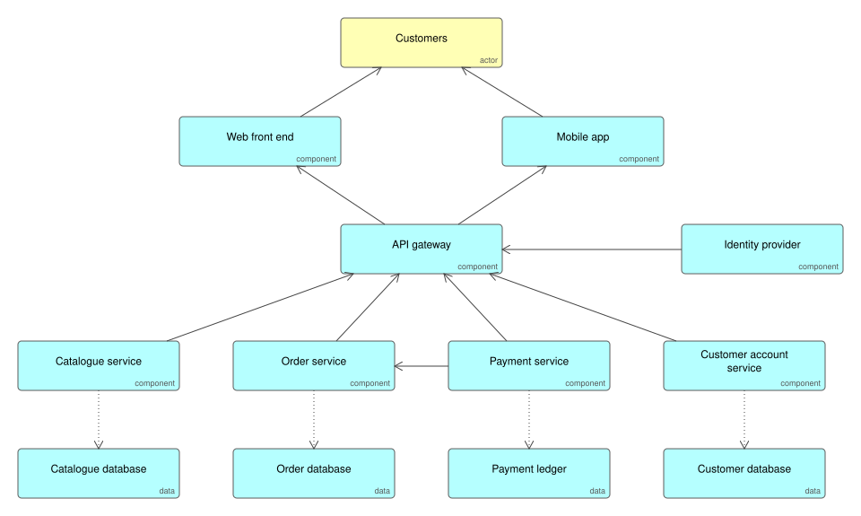

# API Gateway and Microservices

A product split into independently deployable services, each owning its own data, behind one API gateway. Clients see a single API; teams ship their service without coordinating a release with everyone else.

## Use it when

- Several teams work on one product and are slowed by a shared release.
- Parts of the product have very different scaling or reliability needs.

## Trade-offs

- Every network hop adds latency and a new way to fail; budget for timeouts, retries and tracing from the first service.
- Data owned per service means reports and joins across services need their own design, usually events into a reporting store.
- A small team with one product is usually faster with a well-structured single application; split when the organisation, not the code, demands it.

## Files

- `api-gateway-microservices.xml`: the model in ArchiMate Open Exchange format, for Archi, Sparx, BiZZdesign and Entelim.
- `*.svg`: the diagrams above.

## Build it

Ifiok generates each service from one specification, so the boundaries, contracts and gateway routes stay consistent when you change the design. [Start free with Ifiok](https://ifiok.archiet.ai).
