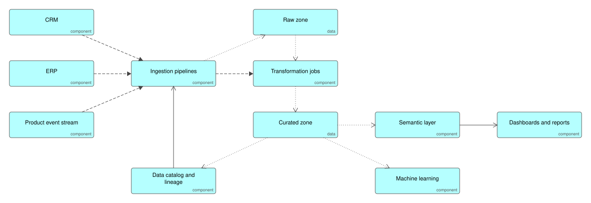

# Modern Data Platform

Operational data flows in from source systems, lands unchanged in a raw zone, is cleaned and modelled into a curated zone, and is served through one semantic layer so every report uses the same definitions. A catalog records where every dataset came from.

## Use it when

- Reports disagree because each one calculates the same figure its own way.
- Analysts and machine learning need the same trusted data.

## Trade-offs

- Keeping raw data costs storage but makes every result reproducible.
- A semantic layer is extra work up front and the only lasting fix for conflicting numbers.
- Without named owners in the catalog, curated data decays back into raw data.

## Files

- `data-platform.xml`: the model in ArchiMate Open Exchange format, for Archi, Sparx, BiZZdesign and Entelim.
- `*.svg`: the diagrams above.

## Build it

Ifiok generates the operational applications whose data feeds this platform, with the entities and events defined once in the specification. [Start free with Ifiok](https://ifiok.archiet.ai).
