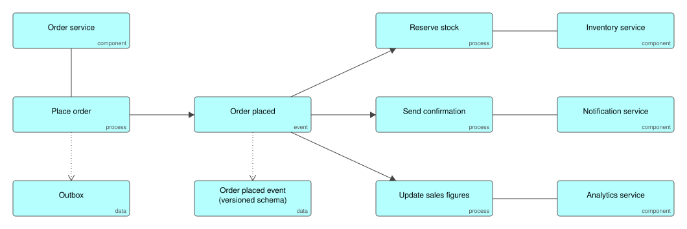
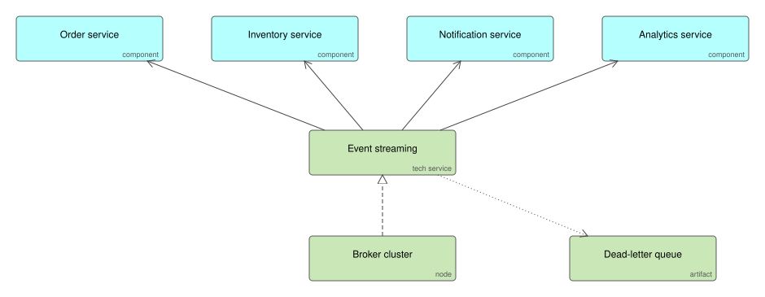

# Event-Driven Architecture

Services announce what happened as events and other services react, instead of calling each other directly. The producer writes the event to an outbox in the same transaction as its own data, so an event is never lost and never published for a change that did not happen.

## Use it when

- Several services need to react to the same business change.
- You want teams to add new consumers without changing the producer.
- You need an auditable, replayable history of what happened.

## Trade-offs

- Consistency becomes eventual: the inventory is reserved shortly after the order, not in the same transaction. Design the user experience for that.
- Delivery is at least once, so every consumer must be idempotent.
- Flows are harder to follow than direct calls; trace ids on every event are not optional.

## Files

- `event-driven.xml`: the model in ArchiMate Open Exchange format, for Archi, Sparx, BiZZdesign and Entelim.
- `*.svg`: the diagrams above.

## Build it

Specify your entities and the events between them, and Ifiok generates the producers, consumers and outbox handling in the stack you choose. [Start free with Ifiok](https://ifiok.archiet.ai).
