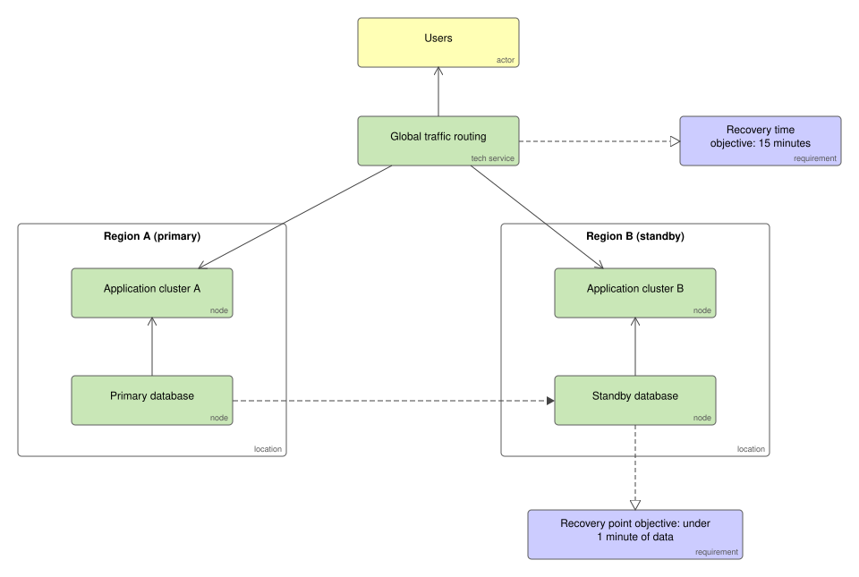

# Multi-Region Resilience (active-passive)

The application runs in a primary region with a warm standby in a second region. The database replicates continuously; if the primary region fails, traffic routing moves users to the standby. Recovery time and recovery point are stated as requirements and tested.

## Use it when

- An outage of one cloud region would cost more than running a standby.
- Regulators or customers require a tested recovery plan with stated recovery times.

## Trade-offs

- Active-passive is simpler and cheaper; active-active removes failover time but needs conflict handling for writes in two places.
- Asynchronous replication means the last seconds of writes can be lost; that number is your recovery point.
- A failover that has never been rehearsed will not work on the day. Test it on a schedule.

## Files

- `multi-region-resilience.xml`: the model in ArchiMate Open Exchange format, for Archi, Sparx, BiZZdesign and Entelim.
- `*.svg`: the diagrams above.

## Build it

Ifiok generates stateless application code, which is what lets a standby region take over without code changes. [Start free with Ifiok](https://ifiok.archiet.ai).
