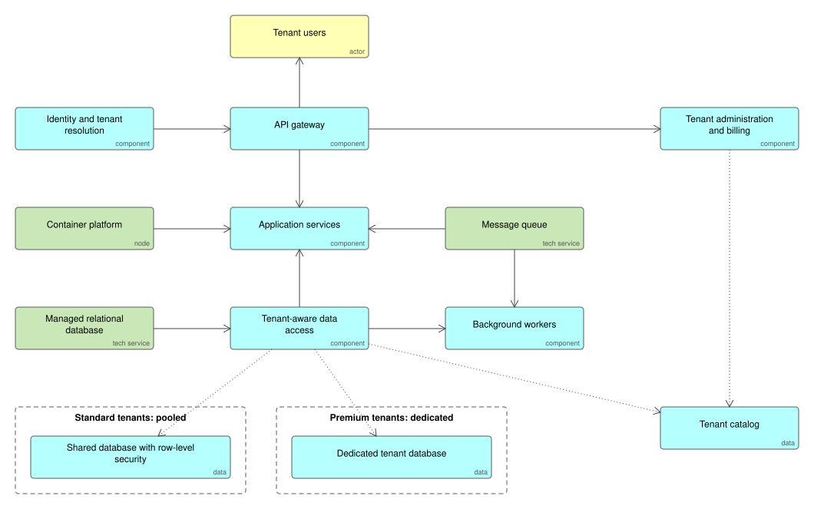

# Multi-Tenant SaaS

One application serving many customer organisations (tenants) from shared infrastructure, with tenant isolation enforced in the data layer. Standard tenants share a pooled database protected by row-level security; premium or regulated tenants get a dedicated database. The tenant catalog records where every tenant lives, so the same code serves both.

## Use it when

- You sell one product to many organisations and need each one's data kept apart.
- You want the cost profile of shared infrastructure, with an upgrade path to dedicated isolation for customers who pay or are required to have it.

## Trade-offs

- Pooled tenants are cheap to run but a defect in isolation exposes everyone, so isolation lives in one component and the database enforces it as well.
- Dedicated databases are simple to reason about but multiply migrations, backups and monitoring by the number of tenants.
- Per-tenant rate limits and queues are what stop one busy customer slowing all others.

## Files

- `multi-tenant-saas.xml`: the model in ArchiMate Open Exchange format, for Archi, Sparx, BiZZdesign and Entelim.
- `*.svg`: the diagrams above.

## Build it

Describe your product and its tenancy rules in a spec, and Ifiok generates the services, tenant-aware data layer and APIs in the stack you choose. [Start free with Ifiok](https://ifiok.archiet.ai).
