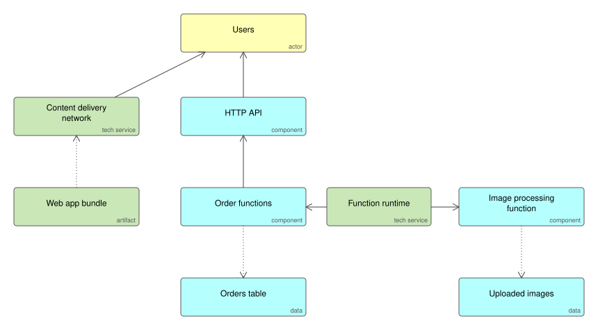

# Serverless Web Application

A web application with no servers to manage: static front end on a content delivery network, an HTTP API backed by functions, and managed data stores. You pay for requests, not idle capacity.

## Use it when

- Traffic is spiky or unpredictable and idle capacity would be wasted.
- A small team wants to ship without running servers.

## Trade-offs

- Cold starts add latency to the first request after a quiet period.
- Cost per request is low but grows linearly; at high steady load, containers are often cheaper.
- Each function is simple; the system of many functions needs the same tracing and deployment discipline as microservices.

## Files

- `serverless-web-app.xml`: the model in ArchiMate Open Exchange format, for Archi, Sparx, BiZZdesign and Entelim.
- `*.svg`: the diagrams above.

## Build it

Ifiok generates the API and its handlers from your specification in the stack you choose, ready to deploy behind a managed API. [Start free with Ifiok](https://ifiok.archiet.ai).
