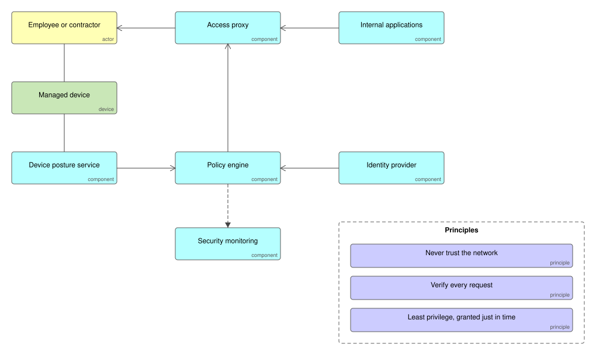

# Zero-Trust Access

No request is trusted because of where it comes from. Every request to an internal application passes an access proxy, which asks a policy engine to decide using the user's identity, the health of their device and the sensitivity of the application, every time.

## Use it when

- Staff work from anywhere and a VPN grants far more access than any one person needs.
- You must show auditors who accessed what, from which device, and why it was allowed.

## Trade-offs

- Policies need owners; a policy engine nobody maintains drifts back to allow-all.
- Device posture checks need managed devices, which is a rollout of its own.
- Moving application by application behind the proxy is slower than a big switch and far safer.

## Files

- `zero-trust-access.xml`: the model in ArchiMate Open Exchange format, for Archi, Sparx, BiZZdesign and Entelim.
- `*.svg`: the diagrams above.

## Build it

Applications Ifiok generates take identity from a token on every request, so they sit behind an access proxy without changes. [Start free with Ifiok](https://ifiok.archiet.ai).
